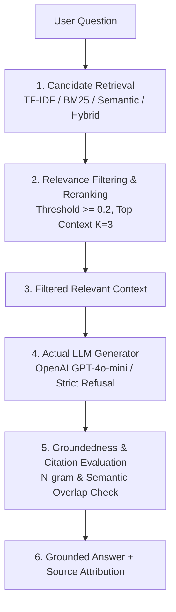
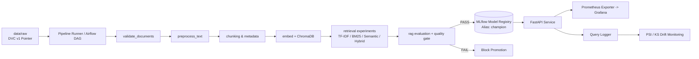

# RAGOps - Monitored Knowledge Assistant for Enterprise Support

Production-grade, end-to-end MLOps pipeline for organizational question answering grounded strictly in verified enterprise documents (HR, IT, travel, leave policies). Features automated candidate retrieval, score-based relevance filtering, actual LLM generation with strict refusal on missing credentials, MLflow tracking & model registry with champion promotion, automated quality gates, PSI/KS data drift detection, and full Prometheus/Grafana observability.



---

## Architecture & End-to-End Pipeline



### Complete 10-Stage Pipeline
1. `ingest_documents`: Validates document SHA-256 hashes against DVC tracked manifests (`data/raw.dvc`).
2. `validate_documents`: Enforces schema, file size, encoding, and duplicate checks across raw documents.
3. `preprocess_text`: Extracts text from `.txt`, `.docx`, `.pdf` and performs clean text normalization.
4. `feature_engineering`: Applies recursive character chunking (512 chars, 64 overlap) and extracts rich metadata (department, access level, effective dates).
5. `build_index`: Computes 384-dimensional dense vectors using `sentence-transformers/all-MiniLM-L6-v2` and builds ChromaDB collection `ragops_v1` (441 chunks).
6. `train_retrieval_models`: Trains TF-IDF and BM25 indexers; benchmarks TF-IDF (baseline), BM25, Semantic, and Hybrid retrievers across 32 gold standard test questions with MLflow run tracking.
7. `evaluate_rag`: Evaluates end-to-end RAG pipeline against an 8-rule Quality Gate (Recall@5, Precision@5, MRR, Groundedness, Citation correctness, Latencies, Abstention).
8. `register_model`: Automatically registers the winning retriever (`semantic`) to MLflow Model Registry (`ragops-retrieval-config`), increments version, and assigns alias `champion`.
9. `drift_check`: Simulates traffic distribution shifts, computes Population Stability Index (PSI) and Kolmogorov-Smirnov (KS) statistics, and generates `data/monitoring/drift_report.json`.
10. `generate_reports`: Automatically regenerates model cards, data cards, performance reports, and drift reports from live run artifacts.

---

## Verified Evaluation & Quality Gate Results

From live execution on 441 document chunks across 32 gold-standard enterprise questions:

### Retrieval Method Comparison
| Retriever | Recall@5 | Precision@5 | MRR | NDCG@5 | Latency (ms) | Status |
|---|---|---|---|---|---|---|
| **Semantic (Champion)** | **0.9167** | **0.6625** | **0.8750** | **0.8395** | 289.58 ms | **Promoted to Champion** |
| Hybrid (BM25 + Dense) | 0.8906 | 0.6375 | 0.8750 | 0.8269 | 226.70 ms | Candidate |
| TF-IDF (Baseline) | 0.9010 | 0.6188 | 0.8438 | 0.8156 | 2.67 ms | Baseline |
| BM25 (Lexical) | 0.8802 | 0.4813 | 0.7943 | 0.7698 | 2.15 ms | Candidate |

### Quality Gate Verification Report
| Metric | Observed Value | Threshold Requirement | Gate Result |
|---|---|---|---|
| **Recall@5** | 0.9167 | $\ge 0.7000$ | **PASS** |
| **Precision@5** | 0.6625 | $\ge 0.5500$ | **PASS** |
| **MRR** | 0.8750 | $\ge 0.6500$ | **PASS** |
| **Groundedness Score** | 0.8828 | $\ge 0.7500$ | **PASS** |
| **Citation Correctness** | 0.8750 | $\ge 0.8000$ | **PASS** |
| **Retrieval Latency** | 289.58 ms | $\le 500.00$ ms | **PASS** |
| **Total Latency** | 290.26 ms | $\le 5000.00$ ms | **PASS** |
| **Abstention Rate** | 0.6667 | $\ge 0.3000$ | **PASS** |
| **OVERALL STATUS** | **PASSED [GREEN]** | All 8 checks passed | **ELIGIBLE FOR PROMOTION** |

---

## API Endpoints

The service exposes both root-level endpoints and versioned `/api/v1` routes:

| Method | Endpoint | Description |
|---|---|---|
| `POST` | `/ask` | Primary RAG endpoint. Accepts question, returns grounded answer, filtered context, and source attribution. |
| `GET` | `/health` | Health check reporting service status and total ChromaDB indexed chunk count. |
| `GET` | `/model-info` | Operational metadata: champion retriever, embedding model, LLM config, chunking strategy. |
| `POST` | `/api/v1/query` | Advanced RAG query endpoint with granular chunk metadata and retriever override. |
| `GET` | `/metrics` | Prometheus metrics endpoint (`rag_requests_total`, `rag_latency_seconds`, etc.). |
| `POST` | `/feedback` | User feedback collection (rating 1-5, comment). |
| `GET` | `/drift` | Summary of current PSI / KS drift metrics from query monitoring. |

### Production LLM Runtime: Local Ollama
- **Primary Engine:** Ollama serving local open-weights LLMs (default: `llama3.2:latest`, configurable to `llama3.1:8b` or `llama3.3:70b` on high-memory hardware).
- **Zero API Cost & 100% Data Privacy:** Enterprise documents are processed entirely on-premises without data leaving your infrastructure.
- **Setup in 3 Steps:**
  1. Install Ollama from [ollama.com](https://ollama.com).
  2. Pull the model: `ollama pull llama3.2:latest`
  3. Ensure Ollama is running at `http://localhost:11434`.
- **In `.env`:**
  ```ini
  LLM_PROVIDER=ollama
  LLM_MODEL=llama3.2:latest
  OLLAMA_BASE_URL=http://localhost:11434
  ALLOW_TEST_MOCK=0
  ```
- **In Offline/Evaluation Environments:** Set `ALLOW_TEST_MOCK=1` in `.env` or CI to allow automated verification using deterministic mock generation without running Ollama.

---

## Quickstart & Local Setup

### 1. Installation
```powershell
# Clone repository
git clone <repo-url>
cd final_mlops_cp

# Install dependencies (CPU-only PyTorch recommended)
pip install torch --index-url https://download.pytorch.org/whl/cpu
pip install -r requirements.txt
```

### 2. Run the Full 10-Stage Pipeline
```powershell
# Runs all 10 stages: ingest -> validate -> preprocess -> chunk -> index -> train -> evaluate -> register -> drift -> reports
python scripts/run_dag_pipeline.py
```

### 3. Run Test Suite (145 tests)
```powershell
pytest -v
```

### 4. Start API Server
```powershell
uvicorn app.main:app --host 0.0.0.0 --port 8000
```
- Swagger UI: [http://localhost:8000/docs](http://localhost:8000/docs)
- Health Check: [http://localhost:8000/health](http://localhost:8000/health)
- Model Info: [http://localhost:8000/model-info](http://localhost:8000/model-info)

---

## Docker & Container Deployment

```bash
# Build Docker image
docker build -t ragops-org-qa .

# Run with Docker Compose (API + MLflow + Prometheus + Grafana)
docker compose up -d
```

| Service | Port | Description |
|---|---|---|
| FastAPI Application | 8000 | Core RAG answering API & health endpoints |
| MLflow UI | 5000 | Experiment runs & Model Registry |
| Prometheus | 9090 | Metrics collection & scrape targets |
| Grafana | 3000 | Real-time monitoring dashboards (`admin` / `admin`) |

---

## Project Structure
```text
final_mlops_cp/
├── app/
│   ├── api/             # FastAPI endpoints (/ask, /health, /model-info, /query)
│   ├── core/            # Configuration management & environment settings
│   ├── data/            # Extraction, cleaning, and text chunking
│   ├── generation/      # LLM generator with strict credential guardrails & evaluation
│   ├── monitoring/      # Prometheus metrics, PSI/KS drift detection, CloudWatch
│   ├── retrieval/       # Candidate retrieval (TF-IDF, BM25, Semantic, Hybrid) & pipeline
│   ├── schemas/         # Pydantic request/response schemas
│   └── vectorstore/     # ChromaDB client & sentence-transformers embedder
├── configs/             # Hyperparameter & pipeline configurations
├── dags/                # Airflow DAG definition (ragops_pipeline_dag.py)
├── data/
│   ├── raw/             # Raw policy documents (HR, Leave, Travel, IT)
│   ├── processed/       # Extracted and chunked text
│   ├── vectorstore/     # ChromaDB persisted dense vector store
│   └── evaluation/      # Gold questions & evaluation reports
├── monitoring/          # Prometheus alerting rules & Grafana dashboards
├── scripts/             # Standalone pipeline runners, evaluation, and AWS scripts
├── tests/               # 145 unit, integration, and API tests
├── Dockerfile           # Multi-stage production container definition
├── docker-compose.yml   # Multi-service stack (API, MLflow, Prometheus, Grafana)
├── Jenkinsfile          # Cross-platform Declarative Jenkins CI/CD pipeline
├── params.yaml          # Pipeline hyperparameters and quality gate thresholds
└── requirements.txt     # Locked production dependencies
```

---

## Continuous Integration & Quality Gates (Jenkins / GitHub Actions)
The repository supports automated CI/CD via **[Jenkinsfile](Jenkinsfile)** and **[.github/workflows/ci.yml](.github/workflows/ci.yml)**:
1. **DVC Pull:** Synchronizes versioned policy data (`dvc pull data/raw.dvc`).
2. **Linting & Testing:** Enforces code quality (`flake8`) and executes test coverage (`pytest`).
3. **Pipeline Execution:** Runs the complete 10-stage RAGOps pipeline (`python scripts/run_dag_pipeline.py`).
4. **Quality Gate:** Checks `quality_gate.json` (blocks deployment if groundedness or citation scores drop below thresholds).
5. **Artifact Build:** Builds container image (`docker build -t ragops-assistant:latest .`).

