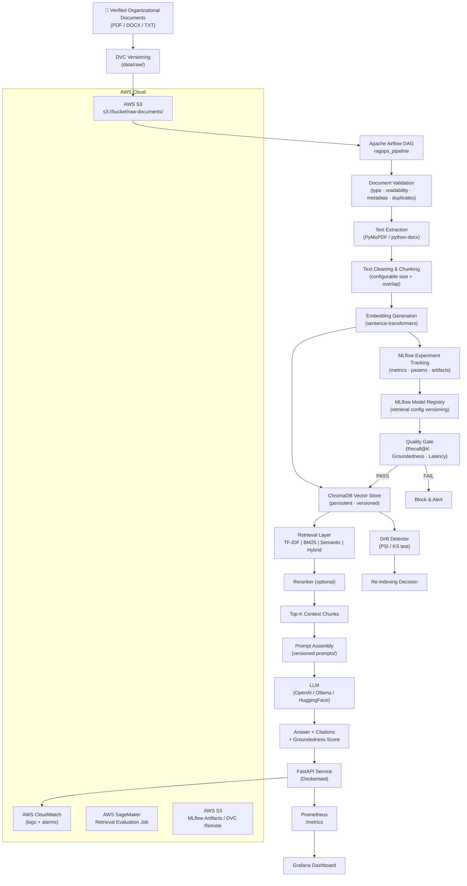
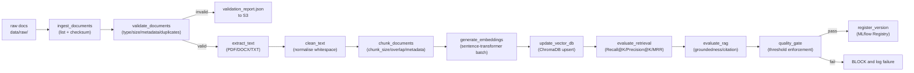
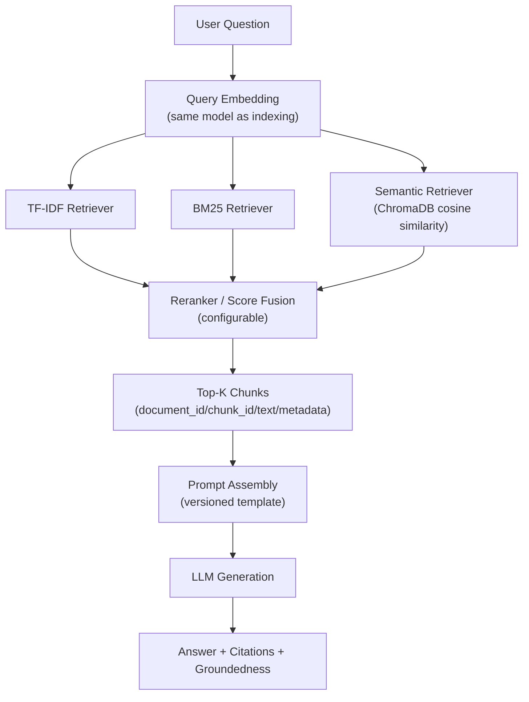
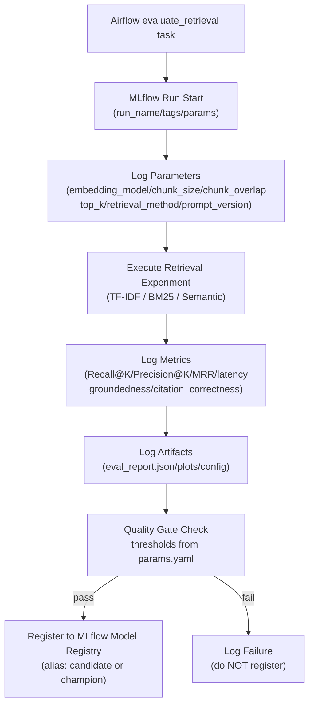
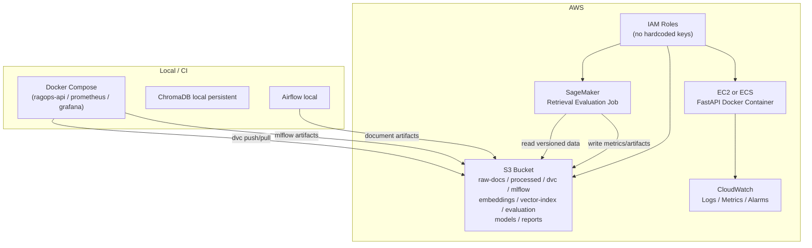
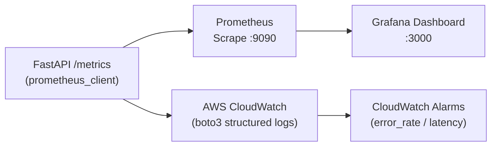
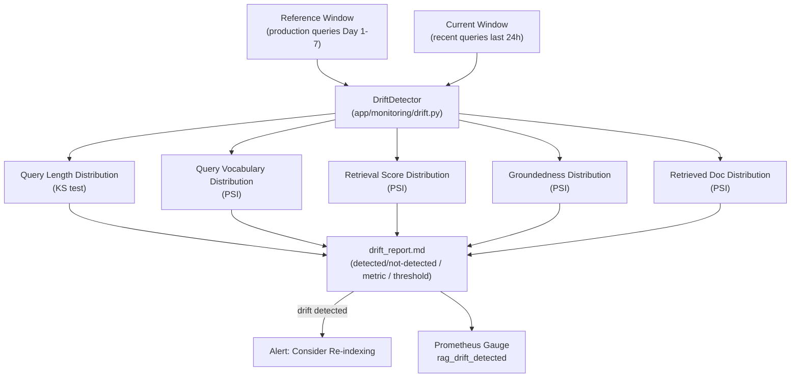

# RAGOps: Monitored Enterprise Knowledge Assistant — Architecture

> **Version:** 1.0  
> **Date:** 2026-10-02  
> **Author:** Student Project — B.Tech AI & DS  

---

## 1. Overall RAGOps Architecture

---

## 2. Document Ingestion Pipeline

---

## 3. Retrieval Pipeline

---

## 4. Airflow DAG

```mermaid
flowchart LR
    T1["ingest_documents"] --> T2["validate_documents"]
    T2 --> T3["extract_text"]
    T3 --> T4["clean_text"]
    T4 --> T5["chunk_documents"]
    T5 --> T6["generate_embeddings"]
    T6 --> T7["update_vector_database"]
    T7 --> T8["evaluate_retrieval"]
    T8 --> T9["evaluate_rag"]
    T9 --> T10["quality_gate"]
    T10 --> T11["register_version"]
```

---

## 5. MLflow Experiment Lifecycle

---

## 6. AWS Architecture

---

## 7. Monitoring Architecture

---

## 8. Drift Detection Architecture

---

## Component Ownership Matrix

| Component | Technology | Environment | Purpose |
|---|---|---|---|
| Raw Doc Storage | Local FS + DVC + S3 | Both | Document versioning |
| Vector Store | ChromaDB | Both | Embedding search |
| Retrieval | TF-IDF / BM25 / Semantic | Both | Candidate generation |
| Reranker | Cross-encoder (optional) | Both | Result reranking |
| LLM | OpenAI / Ollama | Configurable | Answer generation |
| Experiment Tracking | MLflow | Both | Metric/param logging |
| Pipeline Orchestration | Apache Airflow | Both | Reproducible pipeline |
| API Service | FastAPI + Uvicorn | Both | Inference endpoint |
| Containerisation | Docker + Compose | Both | Reproducible deploy |
| App Monitoring | Prometheus + Grafana | Both | ML observability |
| Cloud Monitoring | AWS CloudWatch | AWS | Infra/log observability |
| ML Cloud Workload | AWS SageMaker | AWS | Retrieval eval job |
| Artifact Storage | AWS S3 | AWS | Remote artifacts |
| CI/CD | GitHub Actions | CI | Automated testing |
| Drift Detection | PSI / KS (custom) | Both | Query/retrieval drift |
